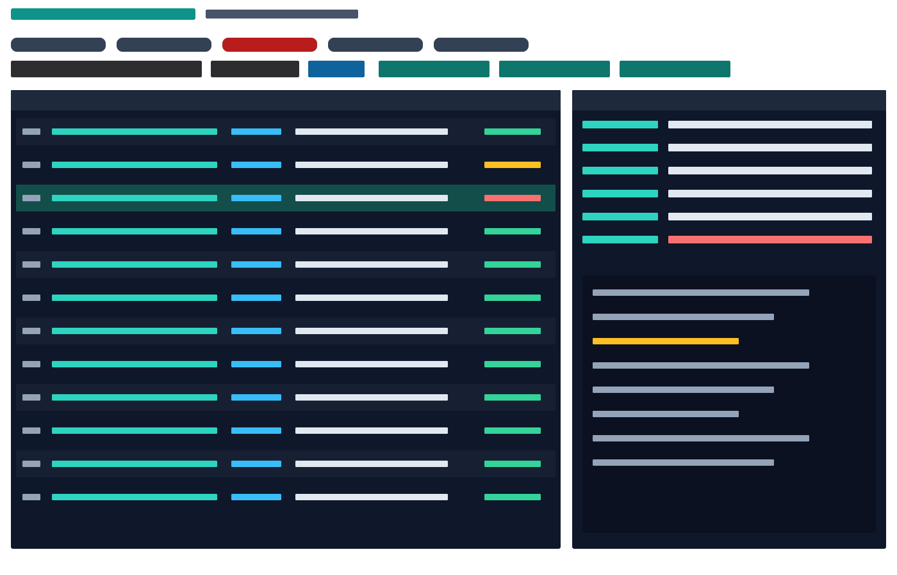

# Helm Chart & Values Viewer for VS Code

Open Helm `Chart.yaml`, `values.yaml`, `values.*.yaml` and `Chart.lock` files in the editor without running `helm` or connecting to a cluster. Production Helm values files grow to hundreds of nested keys where hardcoded passwords, `:latest` image tags, empty `resources: {}` blocks and unpinned chart dependencies are easy to overlook. This extension parses Helm YAML files locally in plain JavaScript with zero cloud calls.

## What it opens

- Helm chart manifests (`Chart.yaml`, `Chart.lock`).
- Helm values files (`values.yaml`, `values.*.yaml`, `values-*.yaml`).
- Nothing to install, no Helm binary required, nothing uploaded.

## The free part

- Nested values explorer: flattens every nested key into dot-notation paths (`image.tag`, `resources.limits.memory`, `postgresql.auth.password`) with type, default value and status badge.
- Chart metadata and dependency tree: displays chart name, version, `appVersion`, `apiVersion` and every dependency from `Chart.yaml` or `Chart.lock` with version, repository and alias.
- Static checks: flags hardcoded secrets and API tokens, `:latest` image tags, empty or missing resource limits, deprecated `apiVersion` strings, unpinned dependency versions and unencrypted `http://` chart repository URLs.
- Search and filter: filter keys by path, value or check status offline.

## The Pro tools, with 1 free try

Pro adds the audit, comparison and documentation steps: generate a Markdown Helm chart security and drift audit report across one file or a chart folder, compare two `values.yaml` environment files (such as staging and production) with secret-safe diffing in Markdown, or export a Markdown and CSV parameter reference table locally. Your first try of each Pro tool is free. Zovo Pro is USD 19 once, and the team licence is USD 59.

## Why not plain YAML

Nested YAML indentation hides which key path a setting belongs to and makes environment drift between `values.staging.yaml` and `values.prod.yaml` tedious to inspect. A local viewer shows flattened key paths, dependencies and security warnings on one screen, offline.

## More tools by Zovo

See full docs and install options at [vscode.zovo.one/extensions/zovo-helm-chart-viewer/](https://vscode.zovo.one/extensions/zovo-helm-chart-viewer/), browse all Zovo VS Code extensions at [vscode.zovo.one](https://vscode.zovo.one/), or explore [Zovo Pro](https://vscode.zovo.one/pro/).
